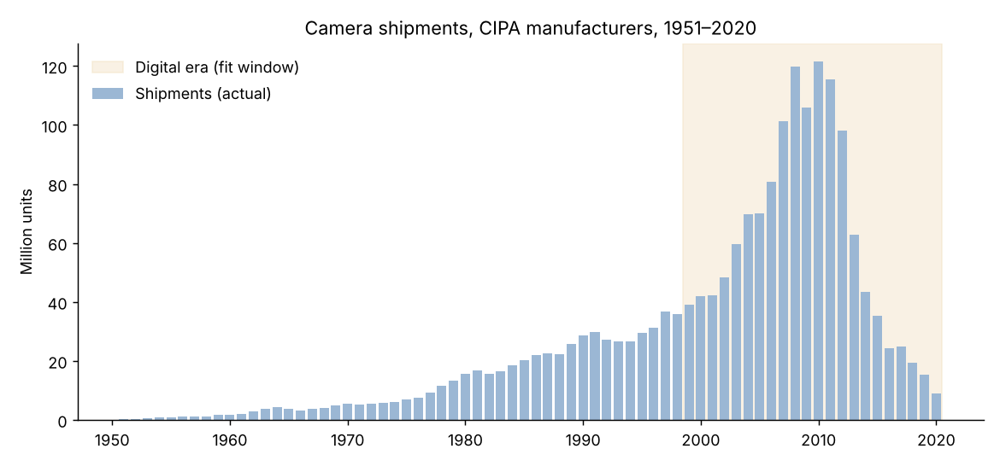
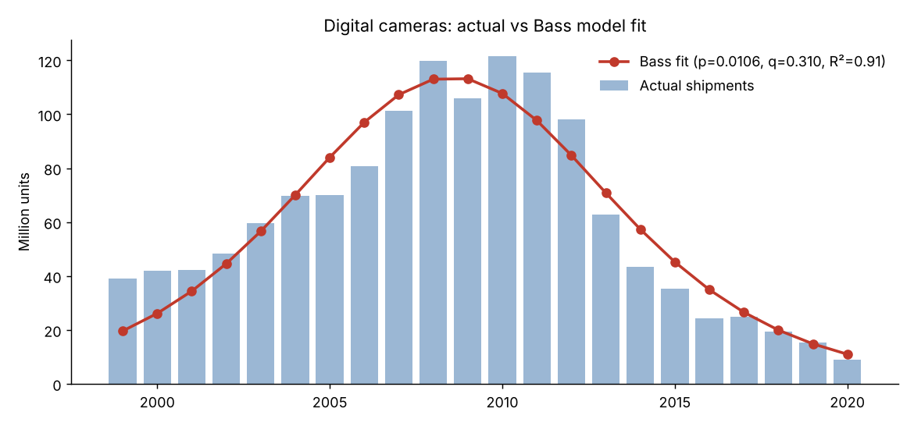
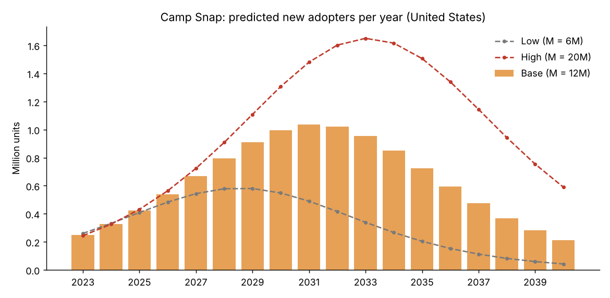
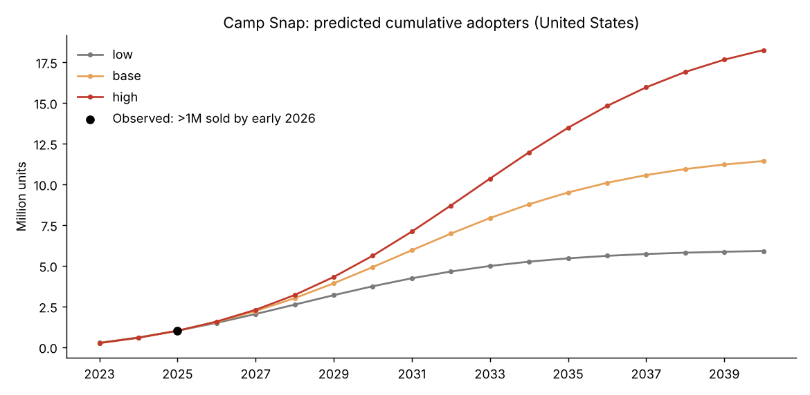

# 1. The innovation

**Camp Snap** — a screen-free digital camera, one of TIME's Best Inventions of 2025.

- TIME entry: <https://time.com/collections/best-inventions-2025/7318270/camp-snap/>

Camp Snap is a simple, child-friendly point-and-shoot digital camera with no screen: like a disposable film camera, you take the picture and only see it later, after downloading. One USB-C charge lasts about 500 shots. It was created by parents Brian and Melanie Waldman for children at summer camps that ban phones, and TIME highlights it as a response to the spread of screen-free policies in schools and camps [1]. It launched in 2023, costs around US$65 [2], and has sold more than one million cameras, mostly through its own online store (about 90 % of sales) plus US retailers such as Target, REI and Best Buy [3].

# 2. Look-alike innovation: the digital still camera

The closest historical analogue is the **digital still camera**. Functionally, Camp Snap *is* a digital camera: it captures images on a sensor and stores them on a memory card, and its core technology (CMOS sensor, digital storage, USB transfer) is what digital compact cameras brought to the mass market from the late 1990s. The difference is a design choice — it deliberately removes the screen — not a new technology.

In market terms the two are also similar: both are inexpensive-to-mid-priced consumer electronics bought for personal and family memories, sold through the same channels, and spread largely by word of mouth and visible use (people see the photos, then buy the device). Camp Snap's own growth has been driven mainly by word of mouth, including a viral moment when it was seen with Taylor Swift [3] — the kind of imitation effect the Bass *q* coefficient captures. The main difference is scale: the digital camera became a near-universal product, while Camp Snap is a niche product for children, families and nostalgia buyers. So we take the **imitation coefficient q** from the look-alike, but estimate Camp Snap's own **market potential M** and calibrate its **innovation coefficient p** to its actual sales.

# 3. Historical data

`data/cameras_and_lenses.csv` contains annual worldwide camera shipments (thousand units, 1951–2020) by member companies of the Camera & Imaging Products Association (CIPA, Japan), as compiled by Statista [4][5]. Shipments peaked at ≈ 121 million units in 2010 and fell to 8.9 million by 2020 as smartphones replaced compact cameras.

{width=92%}

The series spans two generations — film cameras (1951–late 1990s) and digital cameras. Since CIPA began reporting digital still cameras in 1999 and digital models dominated shipments from the early 2000s, the Bass model is fitted on **1999–2020**, the life cycle of the digital camera. The full 1951–2020 fit is reported for comparison.

# 4. Bass model parameter estimation

The Bass model states that the hazard of adoption is $\frac{f(t)}{1-F(t)} = p + qF(t)$, giving

$$F(t)=\frac{1-e^{-(p+q)t}}{1+\frac{q}{p}e^{-(p+q)t}}, \qquad a(t)=M\cdot f(t)=M\frac{(p+q)^2}{p}\frac{e^{-(p+q)t}}{\left(1+\frac{q}{p}e^{-(p+q)t}\right)^2}.$$

Two estimation methods from the lecture were used: (1) non-linear least squares on $a(t)$ (the Python equivalent of R's `nls()`), and (2) Bass's (1969) linear regression $a(t)=\beta_0+\beta_1A(t-1)+\beta_2A(t-1)^2$ with $p=\beta_0/M$, $q=-M\beta_2$.

| Series | Method | M (million units) | p | q | R² | Peak (years after start) |
|---|---|---:|---:|---:|---:|---:|
| **Cameras 1999–2020** | **NLS** | **1,374.6** | **0.0106** (se 0.0017) | **0.3096** (se 0.0203) | **0.91** | **10.5** |
| Cameras 1999–2020 | OLS (Bass 1969) | 1,367.9 | 0.0163 | 0.2951 | – | 9.3 |
| Cameras 1951–2020 | NLS | 1,980.0 | 0.0003 | 0.1064 | 0.62 | 55.4 |
| Smartphones 2007–2020 (benchmark) | NLS | 17,449.7 | 0.0053 | 0.3659 | 0.99 | 11.4 |

{width=92%}

The digital-era fit is good (R² = 0.91) and both methods agree (p ≈ 0.011–0.016, q ≈ 0.30). The values are consistent with Sultan, Farley & Lehmann's (1990) meta-analysis averages (p ≈ 0.03, q ≈ 0.38) [6]: q ≫ p, so diffusion was driven mainly by imitation. The full-history fit is much worse (R² = 0.62) because it forces two technology generations into one curve, which confirms the choice of window. The smartphone benchmark from the lecture gives similar p and q.

# 5. Predicting Camp Snap's diffusion

Rather than copying all three parameters, the prediction combines the analogue with Camp Snap's own data:

- **q = 0.3096** — imitation coefficient from the digital-camera fit (word-of-mouth behaviour is the most transferable part of an analogy).
- **M** — Fermi estimate for the chosen market (Section 7).
- **p** — calibrated so the model reproduces Camp Snap's observed sales: launched 2023, **more than 1 million cameras sold** by early 2026 [3]. Setting $M\cdot F(3) = 1{,}000{,}000$ (end of 2025, $t=3$) and solving for p gives **p = 0.0178** in the base case.

The calibrated p lies between the two analogue estimates (0.0106 NLS, 0.0163 OLS), which suggests the analogy is reasonable: Camp Snap has diffused at roughly the speed digital cameras did, slightly faster at the start.

# 6. Scope: United States

The analysis is **country-specific (United States)**:

- Camp Snap is a US company (founded by a US family) and its sales are concentrated in the US: about 90 % come from its own e-commerce site and the rest from US retailers (Target, REI, Best Buy, Hudson News) [3]; the company website's region selector lists only the United States [7].
- Its core use case — US summer camps and schools with screen-free policies [1] — is a strongly American market; 12 % of US children attend summer camp [8].
- A global model would require guessing shares for markets where the product is hardly sold, while US population data allow a well-referenced Fermi estimate.

The q coefficient comes from worldwide camera data; imitation behaviour for consumer electronics is broadly similar across developed markets, and p is re-calibrated on (mostly US) Camp Snap sales, so the parameters fit a US-level model.

# 7. Market potential and adopters by period

**Fermi estimate of US market potential M (lifetime adopters):**

| Component | Calculation | Adopters |
|---|---|---:|
| US population | ≈ 340 million (Census, Vintage 2024) [9] | |
| Children under 18 | 340M × 21.5 % [10] | ≈ 73.1M |
| Core: children who attend summer camp | 73.1M × 12 % [8] × 50 % eventual adoption (assumption) | 4.4M |
| Other children | (73.1M − 8.8M) × 7.5 % (assumption) | 4.8M |
| Adults (retro/nostalgia, travel, gifts) | (340M − 73.1M) × 1 % (assumption) | 2.7M |
| **Total** | | **≈ 11.9M → M = 12 million** |

Low and high scenarios use M = 6M and M = 20M; p is re-calibrated to the observed 1M sales in each case.

| Scenario | M | p | q | Peak year | Units in peak year | Early majority from | Laggards from |
|---|---:|---:|---:|---:|---:|---:|---:|
| Low | 6M | 0.0379 | 0.3096 | 2028 | 579,898 | 2024 | 2032 |
| **Base** | **12M** | **0.0178** | **0.3096** | **2031** | **1,035,178** | **2027** | **2035** |
| High | 20M | 0.0104 | 0.3096 | 2033 | 1,650,467 | 2029 | 2037 |

Estimated adopters by year (launch 2023 = $t=1$, new adopters $=M[F(t)-F(t-1)]$):

| Year | New adopters (base) | Cumulative (base) | Low (new) | High (new) |
|---|---:|---:|---:|---:|
| 2023 | 247,755 | 247,755 | 259,795 | 243,295 |
| 2024 | 327,263 | 575,018 | 331,493 | 325,539 |
| 2025 | 424,982 | 1,000,000 | 408,713 | 431,165 |
| 2026 | 539,828 | 1,539,828 | 483,129 | 563,412 |
| 2027 | 666,801 | 2,206,629 | 543,449 | 723,387 |
| 2028 | 795,766 | 3,002,395 | 578,214 | 908,097 |
| 2029 | 911,571 | 3,913,966 | 579,898 | 1,108,276 |
| 2030 | 996,510 | 4,910,476 | 548,119 | 1,306,966 |
| **2031** | **1,035,178** | **5,945,654** | 489,812 | 1,480,346 |
| 2032 | 1,019,887 | 6,965,541 | 416,241 | 1,602,040 |
| 2033 | 953,727 | 7,919,268 | 338,869 | 1,650,467 |
| 2034 | 849,310 | 8,768,578 | 266,374 | 1,616,345 |
| 2035 | 724,024 | 9,492,602 | 203,676 | 1,506,255 |
| 2036 | 594,605 | 10,087,207 | 152,466 | 1,340,095 |
| 2037 | 473,529 | 10,560,736 | 112,328 | 1,143,986 |
| 2038 | 367,955 | 10,928,692 | 81,789 | 942,615 |
| 2039 | 280,497 | 11,209,189 | 59,045 | 754,299 |
| 2040 | 210,722 | 11,419,911 | 42,362 | 589,599 |

{width=92%}

{width=92%}

**Interpretation.** In the base case, Camp Snap is still early in its life cycle: about 8 % of its US potential had adopted by the end of 2025. Yearly adoptions keep rising until a peak of about **1.0 million cameras in 2031** ($t^*=\ln(q/p)/(p+q)\approx 8.7$ years after launch), and half of the market (≈ 6M) is reached around 2031–2032. Using the Rogers adopter categories implied by the Bass curve (boundaries at $t^*\pm1.317/(p+q)$ [11]): innovators and early adopters buy until about 2027, the early majority from 2027 to 2031, the late majority from 2031 to 2035, and laggards afterwards. If the market is smaller (low case), the peak comes sooner (2028) and lower; if it is larger (high case), growth continues until 2033 — and in that case the calibrated p (0.0104) is almost identical to the digital-camera p (0.0106).

# Limitations

- q comes from an analogue; a social-media-driven gadget may spread faster than digital cameras did in the 2000s.
- M is a Fermi estimate built on assumed adoption shares; the 6–20M range is the main uncertainty, and the low/high scenarios show how the timing changes with it.
- The calibration uses one reported figure ("more than 1 million" by early 2026), treated as exactly 1M at end-2025; the true number may be higher, which would point to a larger M or faster diffusion.
- Units sold are not exactly adopters (some buyers own several cameras or replace them), a standard limitation when Bass is applied to sales data.
- Competition (Kodak Charmera, other screen-free cameras) and new Camp Snap models could shift the curve.

# References

1. TIME (2025, Oct 9). *Camp Snap — The Best Inventions of 2025.* <https://time.com/collections/best-inventions-2025/7318270/camp-snap/>
2. Domus (2025, Mar 6). *The rise of Camp Snap: like a disposable camera, but digital.* <https://www.domusweb.it/en/news/gallery/2025/03/06/camp-snap-digital-camera-without-screen.html>
3. Modern Retail (2026, Mar 9). *How Camp Snap, Tin Can and more are capitalizing on the desire for "screen-free" tech.* <https://www.modernretail.co/operations/how-camp-snap-tin-can-and-more-are-capitalizing-on-the-desire-for-screen-free-tech/>
4. Statista / M. Brandt (2018). *Worldwide camera sales since 1951* (data: CIPA). <https://de.statista.com/infografik/amp/15540/weltweiter-absatz-von-fotokameras-seit-1951>
5. Camera & Imaging Products Association (CIPA). *Statistics.* <https://www.cipa.jp/e/index.html>
6. Sultan, F., Farley, J. U., & Lehmann, D. R. (1990). A meta-analysis of applications of diffusion models. *Journal of Marketing Research*, 27(1), 70–77.
7. Camp Snap (n.d.). *Why Screen-Free Matters: The Story Behind CampSnap.* <https://www.campsnapphoto.com/blogs/camp-snap-news/why-screen-free-matters-the-story-behind-campsnap>
8. Rustic Pathways (n.d.). *Summer camp statistics* (citing the American Camp Association: 12 % of US children attend summer camp). <https://rusticpathways.com/about/research/summer-camp-statistics>
9. thearp.org (n.d.). Summary of U.S. Census Bureau Vintage 2024 estimates (US population surpasses 340 million). <https://thearp.org/news/net-international-migration-drives-highest-us-population-growth-decades>
10. U.S. Census Bureau (2024). *Under-18 population* (21.5 % of the population, July 1, 2024). <https://www.census.gov/content/dam/Census/library/visualizations/2024/comm/under-18-population.pdf>
11. Mahajan, V., Muller, E., & Srivastava, R. K. (1990). Determination of adopter categories by using innovation diffusion models. *Journal of Marketing Research*, 27(1), 37–50.
12. Bass, F. M. (1969). A new product growth for model consumer durables. *Management Science*, 15(5), 215–227.
